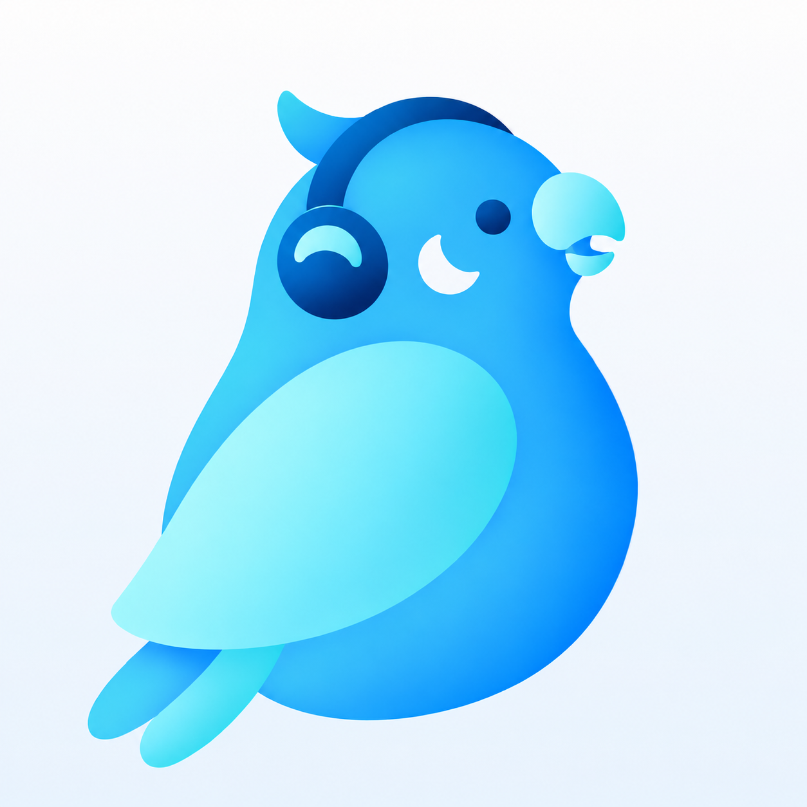

# Parrokit — 내가 모은 문장·단어·클립으로 하는 외국어 공부

Parrokit은 교재를 주지 않습니다. 쓰는 사람이 자기 교재를 모으는 앱입니다.

모으는 것은 세 가지입니다. **문장**은 소리 내어 따라 말하며 익히고, **단어**는 간격을 두고
다시 만나며 외우고, **클립**은 좋아하는 영상의 한 토막에 자막을 붙여 둔 것입니다.

손이 많이 가는 부분은 AI가 채웁니다. 문장에는 뜻과 발음 가이드를, 단어에는 뜻과 예문을
붙여 주고, 영상을 올리면 소리를 받아써 자막을 만듭니다. 빈칸을 채우다 지쳐서 공부를
그만두는 일을 줄이려는 것입니다.

## 주요 기능

**문장** — 직접 적거나, 클립 자막에서 가져오거나, 커뮤니티에서 받아 옵니다.
듣기와 따라 말하기로 연습하면 친밀도가 쌓입니다.

**단어** — 간격 반복으로 복습합니다. 뜻과 유의어, 예문을 함께 둘 수 있습니다.

**클립** — 영상 구간에 자막을 붙입니다. 구간 반복과 배속으로 연습하고,
쇼츠 탭에서 세로로 넘기며 다시 봅니다.

**커뮤니티** — 게시판과 질문, 투표가 있습니다. 문장을 공유하고 남이 공유한 것을 받아 옵니다.

**백업** — 문장·단어·클립 중 고른 것만 한 파일에 담고, 고른 것만 되돌립니다.

**구독** — 무료와 유료 네 단계가 있습니다. 광고, 저장 공간, 하루 AI 한도가 다릅니다.

## 구조

앱 안의 재화와 구독 단계는 서버가 정합니다. 앱은 읽기만 하고, 보안 규칙이 앱의 쓰기를
막습니다. 구독 상태도 RevenueCat 웹훅이 주인이라 앱이 스스로 정하지 않습니다.

사용자 파일은 Cloudflare R2에 둡니다. 학습 자료는 로그인했으면 Firestore에,
그렇지 않으면 기기 안 SQLite에 둡니다.

## 빌려 쓰는 것

음성 인식은 [OpenAI Whisper][whisper], 생성은 [Google Gemini][gemini], 음성 합성은
[ElevenLabs][elevenlabs]와 Google Cloud Text-to-Speech를 씁니다. 결제는
[RevenueCat][revenuecat]이 중개하며 앱은 카드 정보를 만지지 않습니다. 광고는
[Google AdMob][admob], 파일 저장은 [Cloudflare R2][r2]입니다.

모두 [개인정보처리방침][privacy]에 적어 두었습니다.

## 문서

- [이용약관][terms]
- [개인정보처리방침][privacy]

## 라이선스

아직 라이선스 파일이 없습니다. 기본 저작권이 그대로 적용되므로 가져다 쓸 권리는
주어지지 않습니다. 쓰려면 이슈를 먼저 열어 주세요.

## 연락

YU SEOK CHOUNG — <cnsqodla2056@gmail.com>

[whisper]: https://openai.com/research/whisper
[gemini]: https://ai.google.dev
[elevenlabs]: https://elevenlabs.io
[revenuecat]: https://www.revenuecat.com
[admob]: https://admob.google.com
[r2]: https://developers.cloudflare.com/r2/
[terms]: https://www.notion.so/421b6c6245ad81c48b1ed73a4c6ed4a7
[privacy]: https://www.notion.so/421b6c6245ad813f8060ce2b10735561
